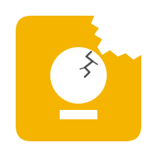

<p align="center">
  
</p>

<h1 align="center">UnKeep</h1>

<p align="center"><strong>Your notes. Your storage.</strong><br>
Your private, self-hosted notes vault — with a useful scratchpad for agents.</p>

<p align="center">
  <a href="docs/self-hosting.md">Self-hosting</a> ·
  <a href="docs/agent-scratchpad.md">Agent scratchpad</a> ·
  <a href="THREAT_MODEL.md">Threat model</a> ·
  <a href="SECURITY.md">Security</a>
</p>

UnKeep is a single-user, Keep-style notes app that you host yourself. It is an
installable PWA that works offline, syncs through one small container you run,
and encrypts notes and attachments on your devices before they leave. The
server only ever stores ciphertext. Terminals and AI agents can use the same
vault through the `unkeep` CLI.

UnKeep is independent software, not affiliated with or endorsed by Google.
Google and Google Keep are trademarks of Google LLC.

> [!IMPORTANT]
> **Hobby project, heavily AI-assisted.** UnKeep was built with substantial AI
> assistance in a domain outside the maintainer's primary expertise. It has
> been reviewed and used daily on a home server, but it is not a polished
> commercial product or a substitute for an independent security audit. Keep
> tested backups, and read the [threat model](THREAT_MODEL.md) before trusting
> it with important data.

## Features

- **Notes and checklists** with labels, 11 colours, pinning, search, and a
  recoverable Trash.
- **Attachments** up to 25 MiB each, with image previews.
- **Works offline.** Edits are saved in the browser first and sync when the
  server is reachable. Conflicting edits become a visible copy instead of
  silently overwriting each other.
- **Keyboard shortcuts** — press `?` in the app to see them.
- **Link previews** (opt-in) under URLs in notes.
- **Google Keep import** from a Takeout archive, plus full vault export and
  restore.
- **Sharing** through the system share sheet, Obsidian, copy, download, or a
  Quick Send link. You can also share *into* UnKeep from Android or iOS.
- **Multiple devices**, paired by comparing a short fingerprint, and
  individually revocable.
- **Agent access** through the `unkeep` CLI with scoped, revocable
  credentials.

## Get started

UnKeep must be served over **HTTPS** (or opened on `localhost`). Browsers only
allow the encryption it uses on secure addresses, so a plain
`http://192.168.x.x:3000` link shows an "UnKeep needs HTTPS" page. Tailscale
Serve, a reverse proxy, or Cloudflare Tunnel all work.

- **Unraid:** install **UnKeep** from Community Applications. See the
  [Unraid settings](docs/self-hosting.md#unraid-settings).
- **Docker Compose:** follow the [self-hosting guide](docs/self-hosting.md),
  which downloads and verifies a release and pins its exact image.
- **Try it locally from source** (Docker required):

  ```sh
  git clone https://github.com/BrettKinny/UnKeep.git && cd UnKeep
  cp .env.example .env && chmod 600 .env
  ${EDITOR:-vi} .env        # set two different random tokens: openssl rand -base64 32
  docker compose --env-file .env up --build -d
  ```

  Then open <http://localhost:3000>.

On the first device, enter the setup token. UnKeep creates your encryption key
in the browser and asks you to save a **recovery kit**. Keep that kit and the
recovery token somewhere safe, and in different places.

The image is `ghcr.io/brettkinny/unkeep`. `latest` and `0.2` follow the newest
stable release; pin an exact version or digest if you prefer. While UnKeep is
`0.x`, a minor release can include breaking changes, so back up before
updating.

## Use it with an agent

Pair the CLI once from your own terminal (`unkeep login`, then approve it in
the app), and mint a credential bundle for each agent or environment
(read-only by default):

```sh
unkeep provision --name "review bot"
unkeep provision --name "release bot" --scope read-write
```

Export the printed `UNKEEP_*` values where the agent runs, then:

```sh
unkeep put --title "Build note" --content "Investigate the arm64 failure"
unkeep list -q arm64 --json
unkeep clip ./report.pdf
```

Every bundle contains the vault key and can read the whole vault; the scope
only limits what it can change. Treat bundles like passwords. The
[agent scratchpad guide](docs/agent-scratchpad.md) covers setup, conventions,
and drop-in instructions for coding agents.

## Security in brief

- The server stores encrypted notes and never receives your vault key. It does
  **not** protect you if the server itself is compromised and serves modified
  app code, or if one of your devices is compromised.
- Compare every character of the fingerprint when pairing a device.
- Quick Send links and anything you share, copy, or download are **not**
  encrypted.
- Back up the server's data folder, the recovery kit, and the recovery token
  separately. None of them is enough on its own.

The [threat model](THREAT_MODEL.md) states the exact boundary.
Report vulnerabilities as described in [SECURITY.md](SECURITY.md).

## Not there yet

UnKeep is one vault for one person. It has no shared editing, reminders,
drawing, OCR, voice notes, note history, or scheduled backups. Markdown
preview supports a safe subset rather than full CommonMark. Browser exports
and Keep imports have size limits (see [configuration](docs/configuration.md#client-limits)).

## Documentation

| Guide | For |
| --- | --- |
| [Self-hosting](docs/self-hosting.md) | Installing, HTTPS, pairing, backups, upgrades, recovery |
| [Configuration](docs/configuration.md) | Every environment variable and limit |
| [Agent scratchpad](docs/agent-scratchpad.md) | Using UnKeep from terminals and AI agents |
| [iOS share shortcut](docs/ios-share-shortcut.md) | Sharing into UnKeep from iOS |
| [Upgrading from previews](docs/upgrading.md) | Notes for vaults created before 0.2.1 |
| [Architecture](docs/architecture.md) | How the code and sync protocol fit together |
| [Threat model](THREAT_MODEL.md) | What UnKeep does and does not protect |

## Develop

Node.js 22.13+ and pnpm 10 are required.

```sh
corepack enable
pnpm install
pnpm dev            # build the packages, then start the web app on :5173
pnpm test           # all workspace tests
pnpm check          # type-check everything
pnpm lint           # lint the web app
pnpm test:e2e       # browser tests
```

See [CONTRIBUTING.md](CONTRIBUTING.md) and the
[architecture overview](docs/architecture.md).

## License

UnKeep source and artwork are [MIT licensed](LICENSE). Dependency licenses are
in [THIRD_PARTY_NOTICES.md](THIRD_PARTY_NOTICES.md). The icon
([`apps/web/static/icon.svg`](apps/web/static/icon.svg)) is original and not
derived from Google Keep artwork.
